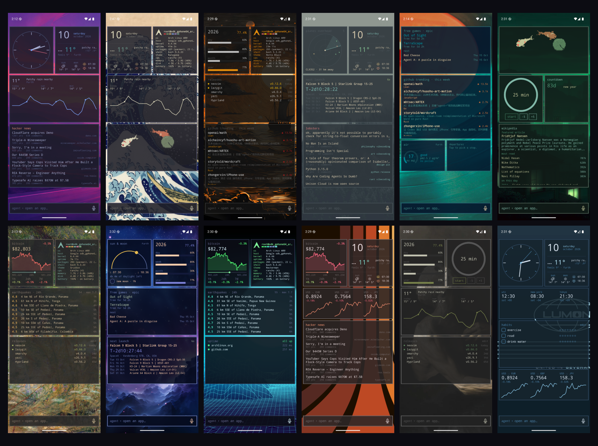
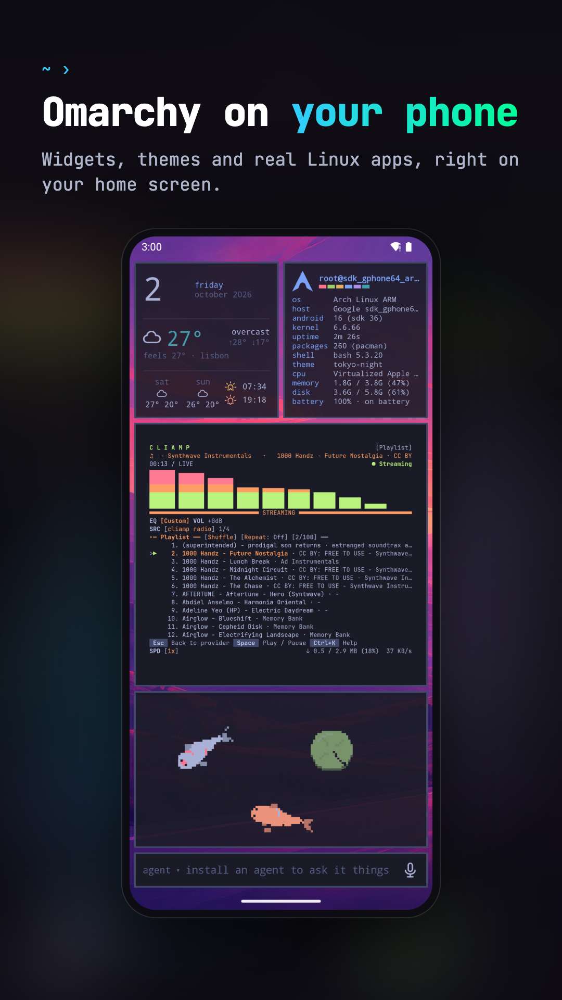
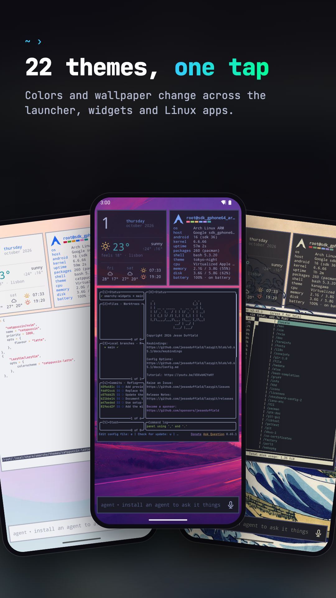
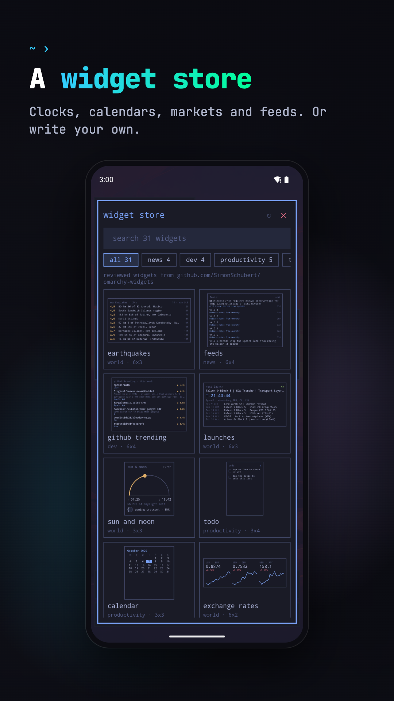
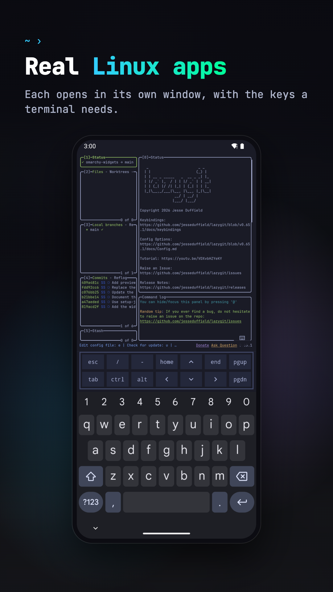

# Larry Launcher (Gentoo chroot)

An Android launcher that runs Linux as a **real chroot of Gentoo's
official arm64 stage3**, started as root through Magisk.

## Gentoo chroot

> **Warning: the guest is real root.** uid 0 in the Gentoo shell is the
> phone's root user, not a fake one. Anything you run there (an emerge, a
> script, a coding agent) can read and change Android, other apps' data and
> the system partitions. The app shows this warning where Linux is turned on.

**Needs** a rooted arm64 phone with Magisk (developed for Android 12). If `su`
is missing or Magisk denies it, Linux stays off and setup shows why; there is
no unprivileged fallback.

### How it works

- **Rootfs**: `files/gentoo`, a fresh stage3 from
  `distfiles.gentoo.org/releases/arm64/autobuilds/latest-stage3-arm64-openrc.txt`.
  The tarball's SHA512 is checked against its `.DIGESTS` before unpacking, and
  the DIGESTS' clearsignature is then checked with the release key the stage3
  ships (`gpg --verify`). It's unpacked as root with Magisk's busybox, so
  owners, setuid bits and device nodes survive.
- **Launch** (`linux/Chroot.kt`, `command()`): every guest command is
  `su -c "exec unshare -m /system/bin/sh -c '…'"`. Inside the private mount
  namespace: `mount --make-rprivate /`, then bind only what the guest needs:
  `/dev` (rbind), `/proc`, `/sys` (rbind), `/tmp` and `/dev/shm` (the app's
  `files/tmp`), `/run/user/0` (the app's `files/xdg`, which holds the
  compositor's `wayland-0` socket), the launcher-data dirs under `/root`, and
  Android's CJK font. Never all of `/data`. Then
  `exec chroot files/gentoo /usr/bin/env -i … /bin/sh -c <command>` with
  `XDG_RUNTIME_DIR=/run/user/0` and `WAYLAND_DISPLAY=wayland-0`. No init and
  no OpenRC/systemd as PID 1: the shell or command runs directly. The mounts
  vanish with the namespace's last process.
- **Killing the guest**: every guest process has `files/gentoo` as its root,
  so `killAll()` runs, as root, a loop over `/proc/*/root` that SIGKILLs each
  match. It runs when the launcher activity finishes, when the Linux service
  stops, before removal and on the next start. Each launch also starts a
  root watchdog outside the chroot that runs the same kill once the
  launcher's pid is gone (the app was force-stopped or killed).
- **Files the launcher reads** (desktop entries, the vdb, the world file,
  `/tmp`, the runtime dir) are relabelled with the app's SELinux context, and
  `/root` chowned to the app's uid, after setup and after each package job:
  files a Magisk root process creates lack the app's categories.
- **Portage**: setup runs `emerge-webrsync`, sets the
  official arm64 binhost in `/etc/portage/binrepos.conf`, trusts its key with
  `getuto` and turns on `getbinpkg`, so most installs are downloads. The
  packages screen searches with `emerge --search` and installs with
  `emerge --noreplace --getbinpkg`; updates are `emerge-webrsync` (or
  `emaint sync`) then `emerge -uDN @world`. Portage's ipc/network/pid/mount
  sandboxes are off.
- **Default packages** are kept small: `gui-apps/foot`, `media-fonts/dejavu`,
  `x11-libs/libxkbcommon[tools]` (keymap), `media-libs/libpulse` (audio
  bridge), and what the bundled widgets run: `sys-process/procps`,
  `sys-apps/gawk`, `app-misc/jq`, `net-misc/curl`, `dev-vcs/git`.
- **Widgets** declare Portage atoms: `requires { portage: ["app-misc/jq"] }`.
  Missing ones are found with `portageq has_version`.

### Checking it on a phone

Not yet tested on a device. To check a build:

1. `adb install -r app/build/outputs/apk/debug/app-debug.apk`, then grant
   root in Magisk when setup asks.
2. In a Gentoo terminal, `grep Uid /proc/self/status` shows `Uid: 0 0 0 0`.
3. foot opens as a window.
4. A widget with a command (fetch, or an example) shows output.
5. `emerge --getbinpkg app-editors/nano` (or `app-misc/neofetch`) installs.
6. Leave the launcher (finish it, or `adb shell am force-stop dev.legendarymsr.larrylauncher`),
   then `adb shell su -c 'for p in /proc/[0-9]*; do readlink $p/root; done | grep gentoo'`
   prints nothing.

<a href="https://play.google.com/store/apps/details?id=dev.legendarymsr.larrylauncher"></a>



<p>
  
  
  
  
</p>

- **Themes**: the bundled themes, applied to the launcher and to the Linux
  apps, or your own in `~/.config/larrylauncher/themes`
- **Widgets** written in OWL, a small declarative language you can edit on the
  phone, with bundled examples
- **Linux, optional**: Gentoo with Portage (binhost first), Linux apps in their own windows,
  terminal widgets, a file manager, and opt-in GPU acceleration on Mali GPUs
- **Coding agents**: the bar at the bottom sends a prompt to Claude Code, Codex,
  Copilot, opencode and others, which open in a terminal
- No account, no ads, no tracking

Needs an arm64 phone with Android 10 or newer. Without Linux, the launcher still
has the themes, wallpapers, Android apps and the widgets that don't run commands.

## Using it

The bar: the one input at the bottom of the home screen opens apps and asks
coding agents. Focusing it opens the list of Linux and Android apps; typing
narrows the list, and Enter opens the highlighted app or sends the text to the
agent. Short queries that name an app open it, sentences go to the agent; Tab
and the arrow keys move the highlight. Tap the agent's name to pick another
installed one; the choice is saved in `~/.config/larrylauncher/agent`. Hold the mic to talk and release to send, or tap it to dictate
into the field. Speech is recognized by Android (on the device when the phone
supports it), so only text reaches Linux.

Touch input in Linux windows: tap is a left click, long press is a right
click, drag scrolls; apps with touch support (foot, GTK) get real touch.
Hardware keyboard shortcuts: Super+Enter (terminal), Super+Space or
Super+A (the bar), Super+1..9 (home pages) on the home screen; Super+Enter
and Super+W (close) in Linux windows.

## Building

```sh
./gradlew :app:assembleDebug
# optional: skip the stage3 download (used as-is: no DIGESTS check for a pushed file)
adb push gentoo-stage3-arm64.tar.xz /sdcard/Android/data/dev.legendarymsr.larrylauncher/files/
```

Tests: `./gradlew :owl:test :app:testDebugUnitTest`. `./gradlew :owl:owlJar`
builds `owl/build/cli/owl.jar`, the standalone widget checker.

In debug builds you can launch guest commands with
`adb shell am start -n dev.legendarymsr.larrylauncher/.MainActivity --es exec foot`.

- [docs/ARCHITECTURE.md](docs/ARCHITECTURE.md): the compositor, rendering, GPU
  acceleration, and how updates reach existing installs
- [docs/RELEASING.md](docs/RELEASING.md): Play releases and store assets
- [app/src/main/assets/widgets/README.md](app/src/main/assets/widgets/README.md):
  the widget language

## Layout

- `app/`: the Android app (Kotlin, Jetpack Compose, and the JNI bridge in `src/main/cpp`)
- `owl/`: the widget language and the `owl` command line, plain Kotlin
- `art/`: SVG masters for the app, agent and store icons
- `store/`: Play listing sources (screenshot frames, privacy policy)
- `fastlane/`: the Play listing and the upload lanes
- `scripts/`: rendering icons, screenshots and the collage

## License

MIT, see [LICENSE](LICENSE), for Larry Launcher's own code and artwork. The
coding agents' logos, the symbol font and the theme colors are not
covered; [THIRD_PARTY.md](THIRD_PARTY.md) lists them with their sources and
licenses. The app lists every third-party component it ships under
settings › licenses.

Larry Launcher is an independent project and is not affiliated with or endorsed
by Gentoo, or the makers of the coding agents it installs.
